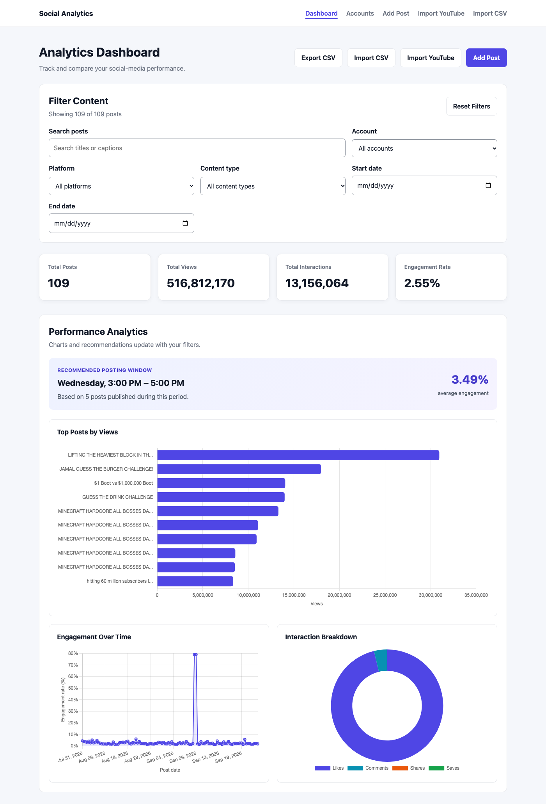
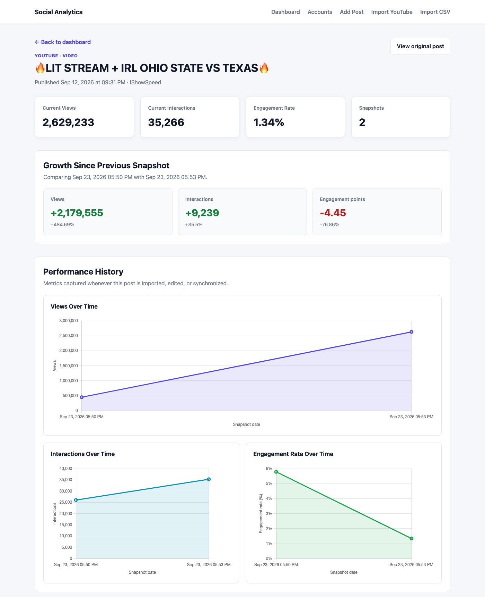
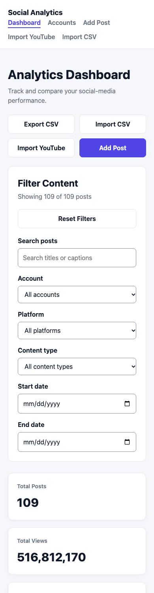

# Social Media Analytics Tool

[](https://github.com/DuhShmere/Social-Media-Analytics-Tool/actions/workflows/tests.yml)

A Flask web application that tracks social-media post performance over time. It imports posts from the YouTube Data API, the Instagram API, CSV files, or manual entry, records every measurement as a historical snapshot, and turns them into engagement metrics, growth trends, and a recommended posting window.



## Features

- **YouTube sync:** import a channel by handle or link, then re-sync to update metrics. Each sync records a new snapshot, so growth can be measured.
- **Instagram sync:** connect an Instagram professional account through Instagram's own login (OAuth), then sync views, likes, comments, shares, and saves. Access tokens are encrypted and renewed automatically.
- **CSV import and export:** row-by-row validation with clear errors, duplicate detection, a downloadable sample file, and formula-safe exports.
- **Manual posts:** add, edit, and delete posts that did not come from YouTube.
- **Analytics dashboard:** filter by account, platform, content type, date range, and text; see totals, engagement rate, top posts, engagement over time, and interaction breakdown.
- **Posting-time recommendation:** the weekday and 3-hour window with the highest engagement, using at least 3 posts.
- **Post history:** per-post growth since the previous snapshot and charts of views, interactions, and engagement over time.
- **Accessible, responsive interface:** keyboard focus styles, skip link, labeled forms, announced messages, and layouts that work on phones.

| Post history | Phone layout |
|---|---|
|  |  |

## Tech stack

**Backend:** Python 3.12, Flask, Flask-SQLAlchemy, Flask-Migrate (Alembic), Flask-WTF, SQLite
**Frontend:** Jinja templates, HTML, CSS, vanilla JavaScript, Chart.js
**Integrations:** YouTube Data API v3 (google-api-python-client), Instagram API with Instagram Login (OAuth 2.0, requests), Fernet token encryption (cryptography)
**Quality and delivery:** pytest (240 tests), GitHub Actions, Docker, gunicorn

## Architecture

```
Browser ──> routes/ (Flask blueprints) ──> services/ ──> models.py ──> SQLite
                                               ├──> YouTube Data API
                                               └──> Instagram API (OAuth)
```

- **`routes/`** holds thin request handlers, one blueprint per feature area.
- **`services/`** holds the business logic for analytics, CSV, and YouTube. It never reads the Flask request, so it is unit-testable without HTTP.
- **Transactions:** services add changes to the database session; the route decides whether to commit or roll back.
- **App factory:** `create_app()` builds the app from a per-environment configuration chosen by `APP_ENV`.

See [docs/ARCHITECTURE.md](docs/ARCHITECTURE.md) for diagrams, the data flows, design decisions, and known limitations.

### Database model

| Table | Purpose |
|---|---|
| `social_account` | A connected channel or account. Unique on `(platform, external_account_id)`. Instagram accounts also store an encrypted access token and its expiry. |
| `post` | A post's current metrics and its `source` (`manual`, `csv_import`, `youtube_api`, or `instagram_api`). Unique on `(platform, external_id)`, which makes re-syncs and re-imports update instead of duplicate. |
| `metric_snapshot` | One row per measurement, deleted with its post. Growth and trend charts compare snapshots. |

Schema changes go through Flask-Migrate. Every unique and foreign-key constraint is named, which SQLite migrations require.

## Getting started

Requires Python 3.12. Commands are for macOS and Linux.

```bash
git clone https://github.com/DuhShmere/Social-Media-Analytics-Tool.git
cd Social-Media-Analytics-Tool

python3.12 -m venv venv
./venv/bin/python -m pip install -r requirements.txt

cp .env.example .env              # then add your YouTube API key
./venv/bin/python -m flask --app app db upgrade
./venv/bin/python app.py
```

Open http://127.0.0.1:5001. The database is created at `instance/tracker.db`.

### Database migrations

```bash
# Apply all migrations (run after pulling changes)
./venv/bin/python -m flask --app app db upgrade

# After changing models.py, generate a migration, review it, then apply it
./venv/bin/python -m flask --app app db migrate -m "Describe the change"
```

### YouTube API setup

1. Open the [Google Cloud Console](https://console.cloud.google.com/) and create a project.
2. Go to **APIs & Services → Library** and enable **YouTube Data API v3**.
3. Go to **APIs & Services → Credentials → Create credentials → API key**.
4. Restrict the key to **YouTube Data API v3**.
5. Put it in `.env` as `YOUTUBE_API_KEY=...`. Never commit `.env`; it is already in `.gitignore`.

Each sync uses 3 quota units: one call each for the channel, its uploads, and the video statistics. The default quota is 10,000 units per day.

### Instagram setup (optional)

Instagram sync uses the **Instagram API with Instagram Login**. It works with Instagram **Business or Creator** accounts; a personal account can switch to Creator for free in Instagram's settings.

1. In [Meta for Developers](https://developers.facebook.com/), create an app of type **Business** and add the **Instagram** product, choosing **API setup with Instagram login**.
2. Under **App roles**, add your Instagram account as an **Instagram tester**, then accept the invitation from Instagram's settings (look for **Apps and websites → Tester invites**; Meta moves this menu occasionally). While the Meta app is in development mode, only tester accounts can connect.
3. Meta requires an **HTTPS** redirect address and does not accept `localhost`. For local testing, run an HTTPS tunnel to the app, for example:
   ```bash
   ngrok http 5001
   ```
4. In the app's **Business login settings**, add the redirect URI `https://<your-tunnel-address>/instagram/callback`.
5. Generate an encryption key for stored tokens:
   ```bash
   ./venv/bin/python -c "from token_vault import generate_key; print(generate_key())"
   ```
   Then add these to `.env`, pasting the printed key, and restart the app:
   ```bash
   INSTAGRAM_APP_ID=your-instagram-app-id
   INSTAGRAM_APP_SECRET=your-instagram-app-secret
   INSTAGRAM_REDIRECT_URI=https://<your-tunnel-address>/instagram/callback
   TOKEN_ENCRYPTION_KEY=the-key-printed-above
   ```
   Keep the key stable: changing it means reconnecting every account.
6. Open the app **through the tunnel address**, not `127.0.0.1`, and choose **Accounts → Connect Instagram**. The login check is tied to the address you started from.

What gets synced: the 50 most recent posts, with likes and comments from each post and views, shares, and saves from Instagram's insights. Instagram documents post captions as unavailable with Instagram Login, so posts are titled by type and date, such as "Instagram Reel · Oct 12, 2026". Instagram image links expire, so thumbnails refresh on each sync.

### CSV format

Required columns: `platform`, `caption`, `content_type`, `posted_at`, `views`, `likes`, `comments`, `shares`, `saves`.
Optional columns: `external_id`, `external_url`.

Dates use ISO format, such as `2026-09-15 14:30` or `2026-09-15T14:30:00-07:00`; offsets are converted to UTC. Download a working example from **Import CSV → Download sample CSV**.

## Configuration

| Variable | Required | Description |
|---|---|---|
| `APP_ENV` | No | `development` (default), `production`, or `testing` |
| `YOUTUBE_API_KEY` | For YouTube features | YouTube Data API v3 key |
| `DATABASE_URL` | In production | SQLAlchemy URL; defaults to `instance/tracker.db` in development |
| `SECRET_KEY` | In production | Signs session cookies and CSRF tokens; generated per run in development |
| `SESSION_COOKIE_SECURE` | No | Production only; set to `false` when serving over plain HTTP |
| `INSTAGRAM_APP_ID`, `INSTAGRAM_APP_SECRET` | For Instagram | From the Meta app's Instagram settings |
| `INSTAGRAM_REDIRECT_URI` | For Instagram | Must exactly match a redirect URI saved in the Meta app |
| `TOKEN_ENCRYPTION_KEY` | For Instagram | Encrypts stored access tokens; generate with `token_vault.generate_key()` |

Production refuses to start without `DATABASE_URL` and `SECRET_KEY`.

## Testing

```bash
./venv/bin/python -m pytest -v
```

The 240 tests use an in-memory database and never touch `tracker.db` or call the real YouTube or Instagram APIs. They cover:

- Analytics calculations and filters
- CSV parsing edge cases
- YouTube sync, using mocked responses that exercise the client library's real retry logic
- The Instagram OAuth flow, token encryption and refresh, and sync, using responses shaped like Meta's documented examples
- Validation and error pages
- CSRF and security headers
- Accessibility checks, including color contrast read from the stylesheet and form labels
- Logging and configuration

GitHub Actions runs the suite on every push, then builds the Docker image, starts it, and checks that it reports healthy.

## Running with Docker

```bash
docker build -t social-analytics .
docker run -p 8000:8000 \
  -e SECRET_KEY="$(python3 -c 'import secrets; print(secrets.token_hex(32))')" \
  -e DATABASE_URL=sqlite:////app/instance/tracker.db \
  -e SESSION_COOKIE_SECURE=false \
  -e YOUTUBE_API_KEY=your-key \
  -v analytics-data:/app/instance \
  social-analytics
```

Open http://127.0.0.1:8000. The container:

- applies migrations on startup
- serves the app with gunicorn as a non-root user
- logs JSON lines
- exposes `GET /health` for its health check

## Security and reliability

- CSRF tokens on every form, and `HttpOnly`, `SameSite=Lax` session cookies
- A strict Content Security Policy (no inline scripts or styles), anti-framing headers, and Chart.js pinned with a Subresource Integrity hash
- Validation on every input; imported links are rendered only if they use `http` or `https`
- Instagram logins are verified with a single-use `state` value, and access tokens are encrypted at rest
- API keys, access tokens, app secrets, and login codes are redacted from all logs, including tracebacks
- YouTube and Instagram requests use timeouts and retry only temporary failures, and no data is written until every API call succeeds
- Structured logs with a request ID on every line, plus a `/health` endpoint that checks the database

## Project structure

```
app.py, app_factory.py, config.py   Entry point, app factory, settings
routes/                             Blueprints: main, posts, imports, instagram, api, health
services/                           analytics.py, csv_service.py, youtube.py, instagram.py
token_vault.py, redaction.py        Token encryption, secret redaction in logs
models.py, validators.py            Database models and input validation
errors.py, security.py,             Error pages, security headers,
logging_config.py                   structured logging
migrations/                         Alembic migrations
templates/, static/                 Jinja templates, CSS, JavaScript
tests/                              pytest suite
docs/                               Architecture notes and screenshots
```

## Roadmap

- Run YouTube syncs in a background job instead of during the web request
- User accounts and authentication
- Live TikTok sync through the TikTok Display API
- Pagination for very large post libraries
