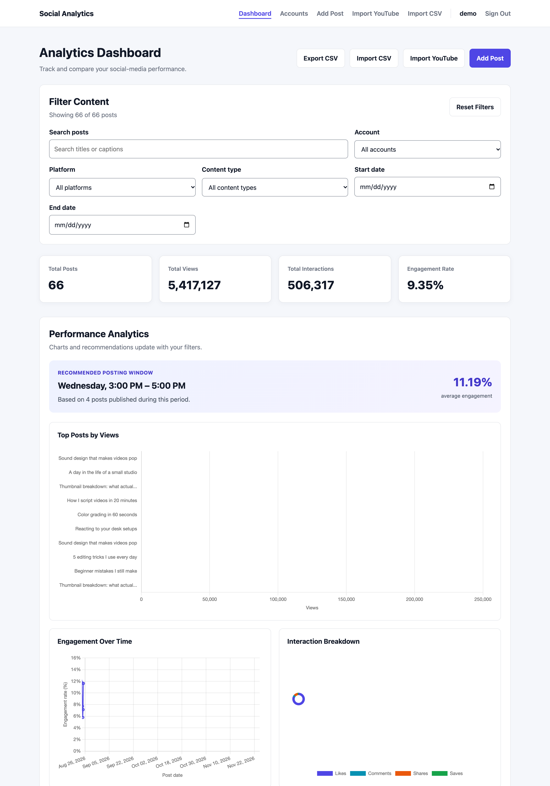
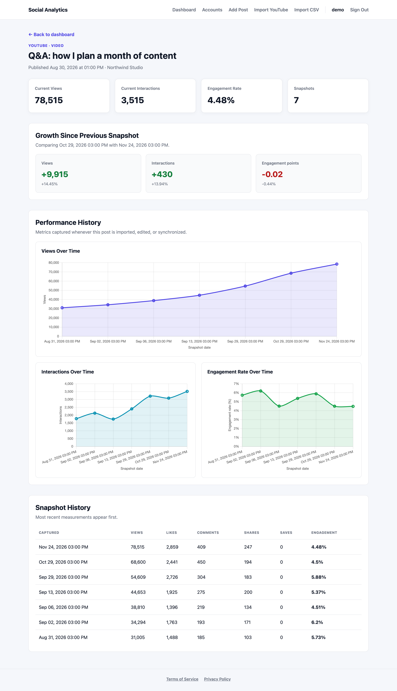
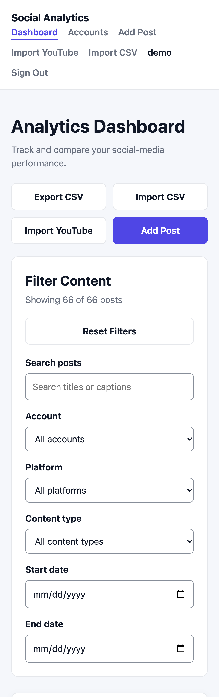
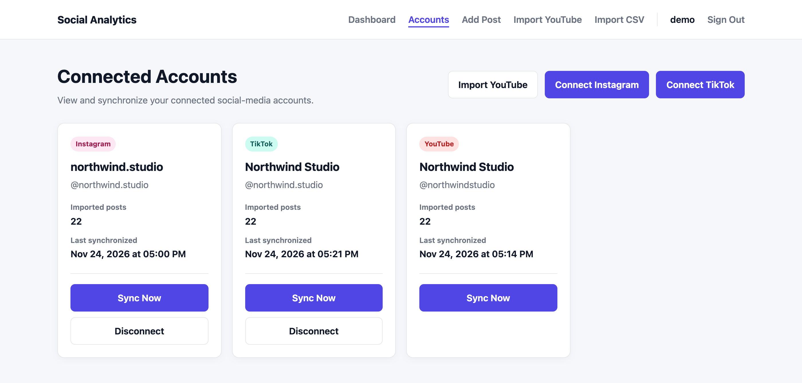
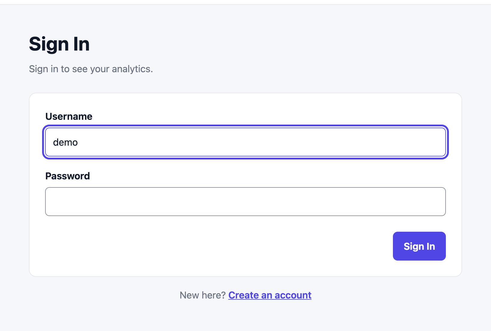

<div align="center">

# Social Media Analytics Tool

**Track how your YouTube, Instagram, and TikTok posts perform over time, all in one dashboard.**

[](https://github.com/DuhShmere/Social-Media-Analytics-Tool/actions/workflows/tests.yml)


[Features](#features) · [Screenshots](#screenshots) · [Quick start](#quick-start) · [Architecture](#architecture) · [Security](#security) · [Testing](#testing)



</div>

## Overview

Social Media Analytics Tool is a Flask web app that pulls post metrics from the **YouTube Data API**, the **Instagram API**, and the **TikTok API**, or from CSV files and manual entry. It records every measurement as a snapshot, so you can see how each post grows, which content performs best, and when your audience engages most.

Each user has their own account, and their connected channels and posts are private to them.

## Features

| | |
|---|---|
| **Three platform integrations** | Import a YouTube channel by handle. Connect Instagram and TikTok through their own OAuth logins. Re-sync at any time to record new metrics. |
| **Growth tracking** | Every sync, import, and edit stores a snapshot, so each post shows its growth since the last measurement and charts its views, interactions, and engagement over time. |
| **Analytics dashboard** | Filter by account, platform, content type, date range, and text. See totals, engagement rate, top posts, engagement over time, and an interaction breakdown. |
| **Posting-time recommendation** | Finds the weekday and 3-hour window with the highest average engagement (based on at least 3 posts). |
| **CSV import and export** | Row-by-row validation with clear errors, duplicate detection, a downloadable sample file, and formula-safe exports. |
| **User accounts** | Sign up, sign in, and change your password. Each user sees only their own data, and repeated failed sign-ins lock the username for 15 minutes. |
| **Accessible and responsive** | Keyboard focus styles, a skip link, labeled forms, screen-reader announcements, and layouts that work on phones. |

## Screenshots

> Screenshots use generated demo data.

<table>
  <tr>
    <td width="62%"></td>
    <td width="38%"></td>
  </tr>
  <tr>
    <td align="center"><b>Post history:</b> growth since the last sync and trends over time</td>
    <td align="center"><b>Phone layout</b></td>
  </tr>
  <tr>
    <td></td>
    <td></td>
  </tr>
  <tr>
    <td align="center"><b>Connected accounts:</b> sync or disconnect each platform</td>
    <td align="center"><b>Sign in</b></td>
  </tr>
</table>

## Tech stack

| Layer | Technologies |
|---|---|
| **Backend** | Python 3.12, Flask, Flask-SQLAlchemy, Flask-Migrate (Alembic), Flask-WTF, SQLite |
| **Frontend** | Jinja templates, HTML, CSS, vanilla JavaScript, Chart.js |
| **Integrations** | YouTube Data API v3, Instagram API with Instagram Login, TikTok Login Kit and Display API (OAuth 2.0) |
| **Security** | Werkzeug scrypt password hashing, Fernet token encryption, CSRF protection, Content Security Policy |
| **Quality and delivery** | pytest (408 tests), GitHub Actions, Docker, gunicorn |

## Quick start

Requires **Python 3.12**. Commands are for macOS and Linux.

```bash
git clone https://github.com/DuhShmere/Social-Media-Analytics-Tool.git
cd Social-Media-Analytics-Tool

python3.12 -m venv venv
./venv/bin/python -m pip install -r requirements.txt

cp .env.example .env                              # then add your YouTube API key
./venv/bin/python -m flask --app app db upgrade   # create the database
./venv/bin/python app.py
```

Open **http://127.0.0.1:5001** and choose **Create an account**. The database is created at `instance/tracker.db`.

### Managing users

```bash
./venv/bin/python -m flask --app app create-user USERNAME    # create an account
./venv/bin/python -m flask --app app set-password USERNAME   # reset a password
```

Both commands prompt for the password without showing it. To close public sign-up, set `SIGNUP_ENABLED=false` in `.env`.

> **Upgrading from a version without user accounts?** `db upgrade` gives your existing accounts and posts to a user named `owner`. That user cannot sign in until you run `set-password owner`.

### Running with Docker

```bash
docker build -t social-analytics .
docker run -p 8000:8000 \
  -e SECRET_KEY="$(python3 -c 'import secrets; print(secrets.token_hex(32))')" \
  -e DATABASE_URL=sqlite:////app/instance/tracker.db \
  -e SESSION_COOKIE_SECURE=false \
  -e YOUTUBE_API_KEY=your-key \
  -v analytics-data:/app/instance \
  social-analytics
```

Open **http://127.0.0.1:8000**. The container applies migrations on startup, runs gunicorn as a non-root user, logs JSON lines, and exposes `GET /health` for its health check.

## Platform setup

YouTube needs only an API key. Instagram and TikTok are optional and use OAuth, which requires an HTTPS address. For local testing, run a tunnel such as `ngrok http 5001` and open the app through the tunnel address.

<details>
<summary><b>YouTube Data API</b></summary>

1. Open the [Google Cloud Console](https://console.cloud.google.com/) and create a project.
2. Go to **APIs & Services → Library** and enable **YouTube Data API v3**.
3. Go to **APIs & Services → Credentials → Create credentials → API key**.
4. Restrict the key to **YouTube Data API v3**.
5. Put it in `.env` as `YOUTUBE_API_KEY=...`. Never commit `.env`; it is already in `.gitignore`.

Each sync uses 3 quota units: one call each for the channel, its uploads, and the video statistics. The default quota is 10,000 units per day.

</details>

<details>
<summary><b>Instagram</b></summary>

Instagram sync uses the **Instagram API with Instagram Login**. It works with Instagram **Business or Creator** accounts; a personal account can switch to Creator for free in Instagram's settings.

1. In [Meta for Developers](https://developers.facebook.com/), create an app of type **Business** and add the **Instagram** product, choosing **API setup with Instagram login**.
2. Under **App roles → Roles**, scroll to the **Instagram Testers** section at the bottom and add your Instagram username. (The plain **Testers** role near the top is a Facebook role and sends no Instagram invite.) Then, in a desktop browser signed in to that Instagram account, open https://www.instagram.com/accounts/manage_access/, choose **Tester Invites**, and accept. While the Meta app is in development mode, only tester accounts can connect.
3. Meta requires an **HTTPS** redirect address and does not accept `localhost`, so run an HTTPS tunnel such as `ngrok http 5001`.
4. On **Instagram → API setup with Instagram business login**, open section **3. Set up Instagram business login** and save the redirect URL `https://<your-tunnel-address>/instagram/callback`. Without it, Instagram's login page shows **"Invalid redirect_uri"**. If Meta saves it with a trailing slash, add the same slash to `INSTAGRAM_REDIRECT_URI`; the app accepts both.
5. Generate an encryption key for stored tokens:
   ```bash
   ./venv/bin/python -c "from token_vault import generate_key; print(generate_key())"
   ```
   Then add these to `.env` and restart the app:
   ```bash
   INSTAGRAM_APP_ID=your-instagram-app-id
   INSTAGRAM_APP_SECRET=your-instagram-app-secret
   INSTAGRAM_REDIRECT_URI=https://<your-tunnel-address>/instagram/callback
   TOKEN_ENCRYPTION_KEY=the-key-printed-above
   ```
   Keep the key stable: changing it means reconnecting every account.
6. Open the app **through the tunnel address**, not `127.0.0.1`, and choose **Accounts → Connect Instagram**. The OAuth check is tied to the address you started from.

**What gets synced:** the 50 most recent posts, with likes and comments from each post and views, shares, and saves from Instagram's insights. Instagram documents captions as unavailable with Instagram Login, so posts are titled by type and date, such as "Instagram Reel · Oct 12, 2026".

</details>

<details>
<summary><b>TikTok</b></summary>

TikTok sync uses **Login Kit** and the **Display API**. While the TikTok app is in **sandbox** mode, it can connect up to 10 TikTok accounts you add as target users, without app review.

1. Sign in at [TikTok for Developers](https://developers.tiktok.com/), open **Manage apps**, and create an app.
2. Switch the app to **Sandbox** and click **Create Sandbox**.
3. Add the **Login Kit** product for the **Web** platform, with the scopes **user.info.basic**, **user.info.profile**, and **video.list**.
4. In Login Kit's settings, add the redirect URI `https://<your-tunnel-address>/tiktok/callback`. TikTok requires `https` and does not allow query parameters.
5. In **Sandbox settings → Target users**, click **Add account** and sign in with your TikTok account.
6. Copy the sandbox's **Client key** and **Client secret** into `.env`, then restart the app:
   ```bash
   TIKTOK_CLIENT_KEY=your-client-key
   TIKTOK_CLIENT_SECRET=your-client-secret
   TIKTOK_REDIRECT_URI=https://<your-tunnel-address>/tiktok/callback
   ```
   `TOKEN_ENCRYPTION_KEY` (from the Instagram steps) is shared.
7. Open the app through the tunnel address and choose **Accounts → Connect TikTok**.

**What gets synced:** the 50 most recent **public** videos, with views, likes, comments, and shares. TikTok's API does not provide saves. The 24-hour access token is refreshed automatically, and disconnecting revokes access on TikTok's side.

</details>

<details>
<summary><b>CSV format</b></summary>

- **Required columns:** `platform`, `caption`, `content_type`, `posted_at`, `views`, `likes`, `comments`, `shares`, `saves`
- **Optional columns:** `external_id`, `external_url`

Dates use ISO format, such as `2026-09-15 14:30` or `2026-09-15T14:30:00-07:00`; offsets are converted to UTC. Download a working example from **Import CSV → Download sample CSV**.

</details>

## Configuration

All settings are environment variables, read from `.env` in development. See [`.env.example`](.env.example).

| Variable | Required | Description |
|---|---|---|
| `APP_ENV` | No | `development` (default), `production`, or `testing` |
| `SECRET_KEY` | In production | Signs session cookies and CSRF tokens. Generated per run in development, which signs everyone out on restart, so set it to stay signed in |
| `DATABASE_URL` | In production | SQLAlchemy URL; defaults to `instance/tracker.db` |
| `SIGNUP_ENABLED` | No | `true` (default) lets anyone create an account at `/signup`; `false` closes it |
| `SESSION_COOKIE_SECURE` | No | Production only; set to `false` when serving over plain HTTP |
| `YOUTUBE_API_KEY` | For YouTube | YouTube Data API v3 key |
| `INSTAGRAM_APP_ID`, `INSTAGRAM_APP_SECRET` | For Instagram | From the Meta app's Instagram settings |
| `INSTAGRAM_REDIRECT_URI` | For Instagram | Must exactly match a redirect URI saved in the Meta app |
| `TIKTOK_CLIENT_KEY`, `TIKTOK_CLIENT_SECRET` | For TikTok | From the TikTok app's sandbox or production settings |
| `TIKTOK_REDIRECT_URI` | For TikTok | Must start with `https` and match a redirect URI saved in Login Kit |
| `TOKEN_ENCRYPTION_KEY` | For Instagram or TikTok | Encrypts stored OAuth tokens; generate with `token_vault.generate_key()` |

Production refuses to start without `DATABASE_URL` and `SECRET_KEY`.

## Architecture

```
Browser ──> routes/ (Flask blueprints) ──> services/ ──> models.py ──> SQLite
                                              ├──> YouTube Data API
                                              ├──> Instagram API (OAuth)
                                              └──> TikTok API (OAuth)
```

- **Routes** are thin request handlers, one blueprint per feature area. Every route loads rows through the signed-in user, so one user can never read or change another's data.
- **Services** hold the business logic for analytics, CSV, and each platform. They never read the Flask request, so they are unit-testable without HTTP.
- **Transactions:** services add changes to the database session, and the route decides whether to commit or roll back. No data is written until every API call in a sync succeeds.
- **App factory:** `create_app()` builds the app from a per-environment configuration chosen by `APP_ENV`.

### Data model

| Table | Purpose |
|---|---|
| `users` | A user account: a unique lower-case username and a scrypt password hash. |
| `social_account` | A connected channel or account, owned by one user. Instagram and TikTok accounts store encrypted OAuth tokens; TikTok adds a refresh token. |
| `post` | A post's current metrics and its `source` (`manual`, `csv_import`, `youtube_api`, `instagram_api`, or `tiktok_api`). Unique per user, platform, and external ID, so re-syncs update instead of duplicating. |
| `metric_snapshot` | One row per measurement, deleted with its post. Growth and trend charts compare snapshots. |
| `failed_login` | Recent failed sign-ins, used to enforce the lockout. |

Schema changes go through Flask-Migrate. See [docs/ARCHITECTURE.md](docs/ARCHITECTURE.md) for diagrams, data flows, design decisions, and known limitations.

## Security

- **Accounts:** passwords are hashed with scrypt and must be at least 12 characters. Sign-in gives the same answer, after the same hashing work, for an unknown username and a wrong password, so usernames cannot be discovered.
- **Lockout:** three failed sign-ins within 15 minutes lock that username for 15 minutes, even for the right password. Failures are stored in the database, so the lock holds across restarts and server workers.
- **Isolation:** each user sees only their own accounts and posts. Another user's post or account answers 404, exactly like one that does not exist.
- **Sessions:** changing a password signs out the user's other devices. Cookies are `HttpOnly` and `SameSite=Lax`, and every form has a CSRF token.
- **OAuth:** Instagram and TikTok logins are verified with a single-use `state` value, tokens are encrypted at rest with Fernet, and disconnecting TikTok revokes its access.
- **Browser:** a strict Content Security Policy (no inline scripts or styles), anti-framing headers, and Chart.js pinned with a Subresource Integrity hash. Imported links render only if they use `http` or `https`.
- **Logs:** API keys, access tokens, app secrets, and login codes are redacted from all log output, including tracebacks.

## Testing

```bash
./venv/bin/python -m pytest -v
```

The **408 tests** use an in-memory database and never touch `tracker.db` or call the real YouTube, Instagram, or TikTok APIs. They cover:

- Analytics calculations, filters, and CSV parsing edge cases
- YouTube sync, using mocked responses that exercise the client library's real retry logic
- Instagram and TikTok OAuth flows, token encryption, refresh, rotation, and revocation
- Sign-up, sign-in, the lockout, password changes, and isolation between users on every route
- Database migrations and the user-management commands
- CSRF, security headers, validation, and error pages
- Accessibility, including color contrast read from the stylesheet and form labels

GitHub Actions runs the suite on every push, then builds the Docker image, starts it, and checks that it reports healthy.

## Project structure

```
app.py, app_factory.py, config.py   Entry point, app factory, settings
cli.py                              create-user and set-password commands
routes/                             Blueprints: auth, main, posts, imports, instagram, tiktok, api, health
services/                           analytics, csv_service, youtube, instagram, tiktok, http
models.py, validators.py            Database models and input validation
token_vault.py, redaction.py        Token encryption, secret redaction in logs
errors.py, security.py,             Error pages, security headers,
logging_config.py                   structured logging
migrations/                         Alembic migrations
templates/, static/                 Jinja templates, CSS, JavaScript
tests/                              pytest suite
docs/                               Architecture notes and screenshots
```

## Roadmap

- Run syncs in a background job instead of during the web request
- TikTok app review, so accounts beyond sandbox target users can connect
- Pagination for very large post libraries
- Scheduled automatic syncs
