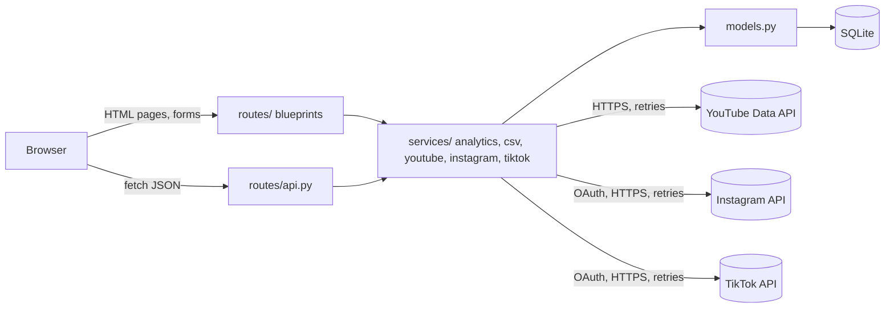
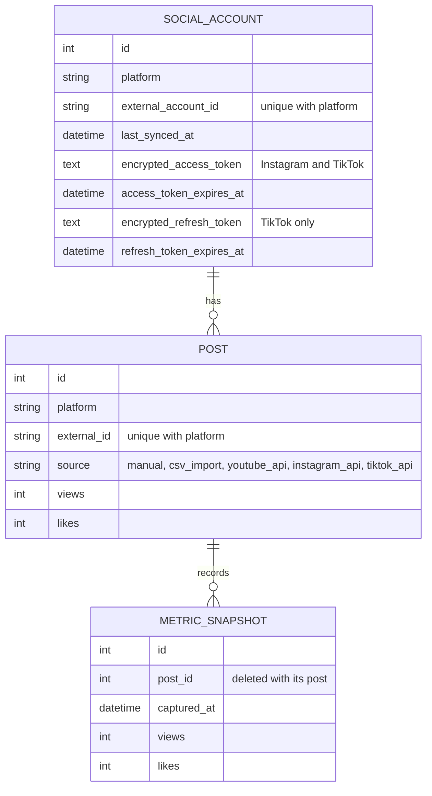

# Architecture

Social Media Analytics Tool is a server-rendered Flask application. It collects post metrics from five sources (manual entry, CSV files, and the YouTube, Instagram, and TikTok APIs), stores every measurement as a snapshot, and reports engagement, growth, and posting-time recommendations.

## Request flow

Pages are rendered with Jinja. The dashboard and post pages then call two JSON endpoints to draw Chart.js charts. Routes stay thin: they read the request, call a service, and commit or roll back.

## Modules

| Layer | Files | Responsibility |
|---|---|---|
| Entry and setup | `app.py`, `app_factory.py`, `config.py` | `create_app()` builds the app from a per-environment config chosen by `APP_ENV` |
| Routes | `routes/main.py`, `posts.py`, `imports.py`, `instagram.py`, `tiktok.py`, `api.py`, `health.py`, plus shared OAuth helpers in `oauth.py` | One blueprint per feature area; 21 URL rules |
| Services | `services/analytics.py`, `csv_service.py`, `youtube.py`, `instagram.py`, `tiktok.py`, plus `http.py` for shared timeouts and retries | Business logic with no dependency on the Flask request |
| Data | `models.py`, `extensions.py`, `migrations/` | SQLAlchemy models and Alembic migrations |
| Input checks | `validators.py` | Shared validation with user-safe error messages |
| Cross-cutting | `errors.py`, `security.py`, `logging_config.py`, `redaction.py`, `token_vault.py` | Error pages, security headers, structured logs, secret redaction, token encryption |
| Front end | `templates/`, `static/js/`, `static/css/` | Jinja templates, vanilla JavaScript, one stylesheet |

## Data model

- A post's current metrics live on `post`. Every create, edit, import, and sync also appends a `metric_snapshot`, so growth and trend charts compare snapshots rather than overwriting history.
- `(platform, external_id)` is unique, which is how re-syncs and re-imports update existing posts instead of duplicating them.
- Only `manual` and `csv_import` posts can be edited or deleted; synced posts are owned by YouTube, Instagram, or TikTok.
- Every unique and foreign-key constraint is named, which SQLite batch migrations require.

## Key flows

**YouTube sync** (`services/youtube.py`). `YouTubeClient` fetches the channel, its 50 most recent uploads, and their statistics. Only then does `sync_channel()` write the account, posts, and one snapshot per video, so a failed API call never leaves partial data. Requests use a 15-second timeout and the client library's retries, which cover only transient failures (5xx, 429, rate limits, dropped connections). Quota and invalid-key errors fail immediately with a specific message.

**Instagram connect and sync** (`routes/instagram.py`, `services/instagram.py`). *Connect Instagram* stores a random `state` in the session and redirects to Instagram's login. The callback accepts only that unused `state`, exchanges the one-time code for a short-lived token and then a 60-day token, and saves the token encrypted with Fernet (`token_vault.py`). Each sync refreshes the token when fewer than 30 days remain, then fetches the profile, the 50 most recent posts, and each post's insights before writing anything. Posts without insights are still saved with their likes and comments. GET requests retry temporary failures; the code exchange is never retried, because the code is single-use.

**TikTok connect and sync** (`routes/tiktok.py`, `services/tiktok.py`). The same single-use `state` check guards the callback (shared in `routes/oauth.py`). TikTok's access token lasts 24 hours and its refresh token 365 days, so both are stored encrypted. Each sync refreshes the access token when under five minutes remain and always keeps the newest refresh token TikTok returns. Refresh and code requests are never retried, but the read-only video-list POST is. TikTok can report errors with HTTP 200, so success is checked from the response body. Disconnect asks TikTok to revoke access and forgets the tokens even if TikTok cannot be reached.

**CSV import** (`services/csv_service.py`). Each row is validated on its own; invalid rows are reported by row number while valid rows still import. Duplicates are skipped by `external_id` or, for rows without one, by matching platform, caption, content type, and time. Exports escape cells that start with `=`, `+`, `-`, or `@` so spreadsheets do not run them as formulas.

**Analytics** (`services/analytics.py`). Filters are parsed into a `PostFilters` dataclass and applied to a query, so the same code serves the JSON API and CSV export. The dashboard's post table filters in the browser for instant feedback, while the charts and summary come from the API.

## Design decisions

- **Services do not read the Flask request.** They take plain values, which keeps them unit-testable without HTTP.
- **The caller owns the transaction.** Services add to the session; routes commit or roll back, so one place decides what is saved.
- **Fail at startup, not at runtime.** Production refuses to start without `DATABASE_URL` and `SECRET_KEY`.
- **Server-rendered pages with small scripts.** No front-end framework; JavaScript only draws charts, filters the table, and manages form loading states.

## Security

- CSRF tokens on every form (Flask-WTF), with `SameSite=Lax` session cookies.
- A strict Content Security Policy with no inline scripts or styles, plus anti-framing and `nosniff` headers. Chart.js is pinned with a Subresource Integrity hash.
- Only `http(s)` links from imported data are rendered as links.
- Instagram and TikTok logins are checked with a single-use OAuth `state`, and OAuth tokens are encrypted at rest; a changed or missing key asks the user to reconnect. Disconnecting TikTok revokes the token with TikTok.
- API keys, access tokens, app secrets, and login codes are redacted from all log output, including tracebacks.

## Operations

- **Health:** `GET /health` checks the database and returns 200 or 503.
- **Logs:** JSON lines in production, with a request ID on every line and per-request timing.
- **Container:** the Dockerfile runs migrations, then gunicorn, as a non-root user with a health check.
- **CI:** GitHub Actions runs 294 tests, then builds the image and checks the running container.

## Known limitations

- Sync runs inside the web request, so a large channel makes the user wait; a background job queue would remove that.
- Only the 50 most recent videos or posts per account are synced.
- Instagram documents captions as unavailable with Instagram Login, so Instagram posts are titled by type and date. Instagram image links expire and are refreshed on each sync.
- Instagram and TikTok connections need an HTTPS redirect address; local testing uses a tunnel such as ngrok.
- TikTok's API returns only public videos and does not provide saves. In sandbox mode, only accounts added as target users can connect.
- There are no user accounts; the app assumes a single trusted user.
- The dashboard renders every post, which suits hundreds of posts but would need pagination for many thousands.
- Only SQLite is tested. `DATABASE_URL` accepts other SQLAlchemy databases, but PostgreSQL would need a driver such as `psycopg` and has not been verified.
